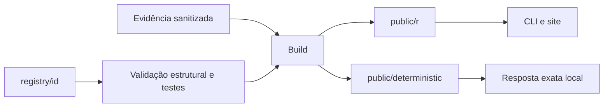

# Registry - Da contribuição ao bundle

> [!tldr] Em linguagem comum
> Uma contribuição entra como código legível com metadados, teste e guia. Os scripts conferem a estrutura e geram os arquivos públicos que o CLI e o site consomem.

← [[00 Hub - agentskit-registry]]

## Passo a passo

| Passo | O que acontece | Quem atua |
|---|---|---|
| Fonte | Pasta por agente com agent.ts, teste, README e meta.json. | [[registry-catalogo]] |
| Validação | Confere campos e arquivos; avaliação comportamental é uma etapa separada. | [[registry-validacao]] |
| Build | Incorpora fontes, classificação e evidências no bundle JSON. | [[registry-catalogo]] |
| Publicação de dados | Gera índices, catálogo, llms e descoberta determinística. | [[registry-descoberta]] |
| Consumo | O site apresenta e o CLI copia os arquivos. | [[agentskit-cli]] |

## Limites e dados

O build só extrai uma skill simples quando encontra exatamente um systemPrompt em template literal. Zero ou vários prompts deixam skill nula; isso não significa que o código do agente não possa ser copiado. `flow.json` oferece decomposição opcional para agentes com etapas e guardas.

> [!info]- Detalhe técnico
> - `agentskit-registry/scripts/validate-agents.mjs:14` — arquivos e campos exigidos
> - `agentskit-registry/scripts/build-registry.mjs:47` — leitura dos agentes
> - `agentskit-registry/scripts/build-registry.mjs:64` — extração opcional de um prompt
> - `agentskit-registry/scripts/build-registry.mjs:142` — draft não entra no índice instalável
> - `agentskit-registry/scripts/build-registry.mjs:193` — índice público
> - `agentskit-registry/scripts/build-registry.mjs:326` — artefato determinístico
