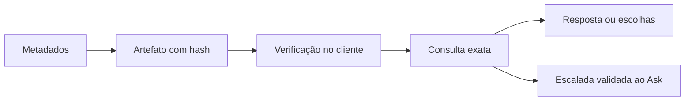

# Registry - Descoberta sem IA

> [!tldr] Em linguagem comum
> O catálogo produz uma lista verificada de fatos exatos para a interface responder sem gastar uma chamada de IA. Recomendações e comparações de significado continuam sendo trabalho do backend.

← [[00 Hub - agentskit-registry]]

## Passo a passo

| Passo | O que acontece | Quem atua |
|---|---|---|
| Fonte | Lê metadados e manifesto do catálogo. | [[registry-catalogo]] |
| Artefato | Monta entradas e configuração de site com hash de conteúdo. | [[registry-descoberta]] |
| Contrato | Reutiliza schemas e verificação de integridade do AgentsKit Chat. | [[chat-protocol]] |
| Site | Carrega e verifica o artefato antes de montar o widget. | [[agentskit-registry]] |
| Escalada | Somente uma ausência validada encaminha a pergunta semântica. | [[chat]] |

## Limites e dados

O hash SHA-256 detecta alteração de conteúdo e vincula configuração ao artefato; não é, por si só, assinatura criptográfica de autoria. A expressão “signed local artifact” do README deve ser lida com essa distinção. O código do protocolo é reutilizado, não copiado.

> [!info]- Detalhe técnico
> - `agentskit-registry/scripts/lib/deterministic-discovery.mjs:65` — criação do artefato
> - `agentskit-registry/scripts/lib/deterministic-discovery.mjs:212` — fontes canônicas
> - `agentskit-registry/scripts/build-discovery.mjs:13` — geração e gravação de knowledge e site-config
> - `agentskit-registry/docs/architecture.md:46` — limite da busca determinística
